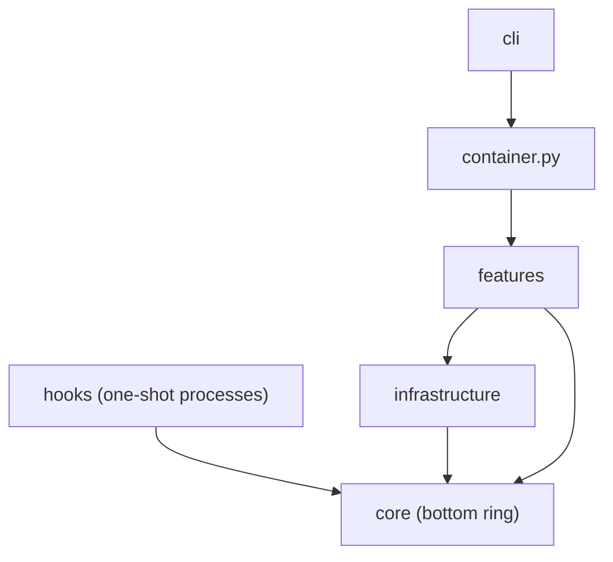
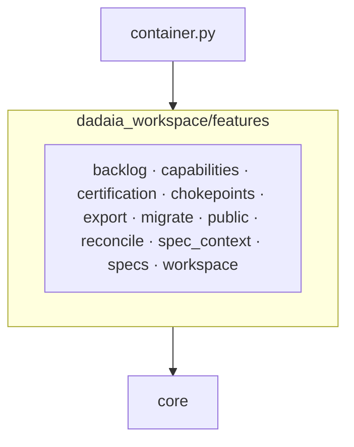

## Principles

### P-01 · We keep the dependency ring: core imports nothing internal, infrastructure imports only core, no layer imports upward; a feature imports the concrete infrastructure class it alone consumes.
Measured by: `lint-imports --config setup.cfg --no-cache` — contracts `core-no-upper-layers` and `infrastructure-no-upper-layers` (zero ignored imports).
Rationale: the ledger shows zero adapter substitutions ever fixed a bug; the port requirement only grew the container funnel.

### P-02 · We never spawn a subprocess from a feature; process execution goes through the one infrastructure adapter, `infrastructure/subprocess_runner.py`.
Measured by: `lint-imports --config setup.cfg --no-cache` — contract `features-no-subprocess` (direct imports only, zero ignored edges).
Rationale: one process seam keeps execution observable, fakeable and bounded.

### P-03 · We keep `core` free of OS primitives (`fcntl`, `signal`, `subprocess`, `msvcrt`); every host fact is decided by the skill kernel's `_platform.py`, and `core/platform.py` is the package's one door to it.
Measured by: `lint-imports --config setup.cfg --no-cache` — contract `core-no-os-primitives`.
Rationale: a POSIX-only primitive in the bottom ring breaks every importer on Windows.

### P-04 · We make `core` the bottom ring: it imports no `features`, `infrastructure`, `cli` or `hooks`.
Measured by: `lint-imports --config setup.cfg --no-cache` — contract `core-no-upper-layers` (zero ignored imports).
Rationale: the ring everything imports must import nothing, or the graph has a cycle.

### P-05 · We let `infrastructure` depend on `core` only — never on `features`, `cli` or `hooks`.
Measured by: `lint-imports --config setup.cfg --no-cache` — contract `infrastructure-no-upper-layers` (zero ignored imports).
Rationale: an adapter that knows a use case is no longer an adapter.

### P-07 · We keep features mutually independent: they compose through the container, never through sibling imports; a helper two features need lives in each.
Measured by: `lint-imports --config setup.cfg --no-cache` — contract `features-no-cross-feature`, whose `modules = dadaia_workspace.features.*` covers every features package.
Rationale: a hand-kept `modules =` list hid three real sibling edges from the check.

### P-09 · We resolve the whole Invocation — workspace root, session, context, specs dir, the session's Bind — once per process in `core.invocation.resolve`, imported directly only by `cli._specs_resolution`, `container` and `hooks`.
Measured by: `lint-imports --config setup.cfg --no-cache` — contract `bind-resolution-seam-is-a-single-home` (zero ignored imports, none ever accepted); `pytest tests/core/test_invocation.py`.
Rationale: every context bug came from a second resolution path answering differently.

### P-10 · We cap every suppressed layering edge and ratchet the cap only downward; an edge is added with its reason and the cap moved in the same commit.
Measured by: `poetry run python scripts/guards/run.py` prints `PASS ignore-cap` — `scripts/guards/slop.py`'s `IGNORE_EDGES` is the cap's one numeric home.
Rationale: a pinned exception list turns every new suppression into a reviewable diff.

### P-11 · We keep `core` file-I/O pure outside an authorized set of eight modules; new file I/O enters `core` only by joining that set on purpose.
Measured by: `pytest 'tests/core/test_atomic_write__core_file_io_purity.py::test_each_question_has_one_owner[core-file-io-purity]'` (AST walk; every authorized stem must exist).
Rationale: joining the set is legal; arriving there unnoticed is not.

### P-12 · We never import the composition root from a hook; hooks reach the resolution authority directly because they are one-shot processes on the write hot path.
Measured by: `pytest tests/core/test_atomic_write__core_file_io_purity.py -k never_imports_the_container` (`test_importing_a_hook_never_imports_the_container` over five hook modules, and `test_gate_resolution_path_never_imports_the_container` over the executed gate path, each with `container` absent from `sys.modules`).
Rationale: the composition graph costs seconds of import time per gated tool call.

### P-13 · We keep the architecture diagrams derived from live code: every diagrammed class, view module and feature package is introspected against the live tree.
Measured by: `dadaia doctor` — `specs`-section rule `MEM-DRIFT-1` (`features/specs/doctor_memory.py`), one WARNING per package the map and the live tree disagree on.
Rationale: a diagram nobody checks is the first artifact to lie.

### P-14 · We keep the release-state reader pure: `core/release_state.py` parses and serializes already-read text and performs no file I/O.
Measured by: `pytest 'tests/core/test_atomic_write__core_file_io_purity.py::test_each_question_has_one_owner[release-state-module-never-writes]'`.
Rationale: a reader that can write is a reader that can rewrite history.

### P-15 · We close the release-state envelope: `release-state-v1` carries `additionalProperties: false` at every level, a closed log-entry shape, and no harness `session_id`.
Measured by: `pytest tests/core/test_handoff_index__handoff_schema_contract.py`.
Rationale: an open envelope accumulates fields until no consumer can fold it.

### P-17 · We keep the agentic-law registry structurally complete: every shipped skill and scoped `AGENTS.md` source maps to one law section, every section has an owner, persona grants exclude non-invokable skills, source and projection references resolve, and law citations name live paths, commands and body targets.
Measured by: `pytest tests/infrastructure/test_entity_doctor.py`.
Rationale: structural ownership and resolvable relationships keep agentic law reachable and enforceable without duplicating its content.

### P-30 · The version, the CHANGELOG section and the tag of a release come from release-please over Conventional Commits, and promote is merging its release PR.
Measured by: `poetry run python scripts/guards/run.py` prints `PASS release-workflow-canon` (the release workflow, the release-please manifest and config, the `pyproject.toml` version equal to the CHANGELOG's top dated section).
Rationale: a hand-minted version is one more writer of one fact; the commit history already holds it.

### P-31 · We hold every repo INSIDE the workspace under `repos/<slug>/`, each its own git repository with its own `specs/`; the workspace is never a monorepo, one repo is the degenerate case of many, and bootstrap is one command (`init <dir> --harness <name> [--repo <url>]`).
Measured by: `pytest tests/e2e/test_one_line_bootstrap.py tests/core/test_workspace_resolver.py`.
Rationale: the law, the harness projections, the zones and the venv live outside every repo; a per-repo or monorepo tool cannot govern ten projects with one law.

### P-32 · We reconcile product memory from the window's code diff at every closure — delete, update, then add — recorded as one `kind: memory` entry naming every drifted atom.
Measured by: `poetry run python scripts/guards/run.py` prints `PASS memory-canonical-shape`; `dadaia doctor` — `specs`-section rule `LINT-1` (history lines).
Rationale: three closures touched every product atom and left fifteen contradicted by the code; an append protocol stacks, a diff-driven one deletes first.

## Tech Stack

- Python `^3.12`, built by Poetry Core; console entrypoints `dadaia` and `dadaia-workspace` are one callable, and the version lives in `pyproject.toml` alone.
- Runtime dependencies: Typer, Rich, jsonschema, packaging (PEP 440 version ordering); the package declares no optional extra, and frontmatter is parsed by the kernel's stdlib parser.
- Everything else is the standard library; there is no database — every state is a JSON or JSONL file.
- Claude Code, Codex, Kimi Code, Cursor, Devin CLI and GitHub Copilot are operator-installed external CLIs, never Python dependencies; the workspace runs no agent-execution runtime.
- Quality toolchain: pytest (`pytest-cov`, `pytest-xdist`, `pytest-randomly`, `pytest-timeout`, Hypothesis), PyYAML (the frontmatter parser's differential reference), Ruff, mypy `--strict`, import-linter; all in the dev group.
- Secret scanning: gitleaks, a CI action in `secret-scan.yml`, never a Python dependency.
- Packaging: wheel and sdist ship the `dadaia_workspace` package with `public/` inside it and no bytecode.
- Canonical commands, from the workspace root:

```bash
.dadaia/.venv/bin/dadaia --version
.dadaia/.venv/bin/python -m pytest
.dadaia/.venv/bin/dadaia doctor
.dadaia/.venv/bin/dadaia public doctor
.dadaia/.venv/bin/dadaia certify --json
```

## Structure



- `container.py` is composition wiring only: every definition keeps a production consumer, and a single-consumer adapter is imported directly by its feature.
- No `core/protocols/` package exists: no seam carries two production adapters, so every adapter is imported by its one consumer; a `typing.Protocol` lives only as a structural type inside the module that consumes it.
- `setup.cfg` carries seven import-linter contracts; `features-no-subprocess` and `features-no-cross-feature` have no suppressed edge (P-10).
- Hooks import `core.invocation` directly and build the `Invocation` once per process (P-12); `sdd_post_gate` touches `last_seen_at` and writes nothing else.
- The package/skill seam (ADR 0246): every shared fact has one owner, a skill script; the cross-cutting ones (refusal, git runner, JSONL, atomic writer, frontmatter parser, clock, the OS boundary `_platform.py`, workspace-root walk, privacy matcher) live in `public/skills/dd-bug-resolution/scripts/`, the kernel, and each ledger schema in its writer skill's `scripts/schemas/`. `core/skill_owner.load_owner` loads an owner by absolute path as one module object, and no copy is staged or projected.
- `core/atomic_write.py`, `core/clock.py`, `core/frontmatter.py`, `core/platform.py` and `core/redaction.py` are typed doors over their kernel owners and import only `core.skill_owner` among the package's modules (ADR 0246).
- `features/migrate` stamps `specs_pattern_version: 13` (`core/specs_version.CANONICAL_SPECS_VERSION`) or refuses; a tree below v6 is foreign, and `specs init --replace-foreign` moves it to `specs-bkp/` before the canon is scaffolded.

### `dadaia_workspace/features` — package map (11 packages)



### Accepted decisions (generated from `specs/ADRs/decisions.jsonl`)

<!-- dadaia:fixed adr-list -->
- 0007 — Rename RELEASE.json to _RELEASE.json everywhere, including specs/releases/_archive/**, with a doctor-fixable legacy rename
- 0015 — The workspace holds repos inside it, never a monorepo; one workspace with one repo is the minimal case, and bootstrap is one command
- 0018 — The CLI keeps only what touches .dadaia/; everything that touches only specs/ or a state JSON is a minimal stdlib script under the owning dd- skill
- 0020 — Lazy multi-harness: init requires one harness, harness add adds another, and the roster extends to Cursor, Devin CLI and GitHub Copilot only after demolition and context concentration
- 0021 — Version, CHANGELOG and tag come from release-please over Conventional Commits; rc-N archiving, release fold and the birth-minted version retire
- 0023 — Memory canon v7: canonical memory (ARCHITECTURE.md with its Tech Stack section, QUALITY.md) changes only with an accepted ADR; product memory is reconciled from the window's git diff at closure, delete then update then add, under a doctor gate; TECHSTACK.md and the Part 1/Part 2 split retire
- 0025 — No CI job calls a model API; the security review is the dd-code-reviewer security lens before every PR
- 0027 — context create is the one level-2 verb: clone, hook, ALIVE and bind in one transactional step; the frozen-surface law is amended
- 0028 — Onboarding status is derived from disk on every read; no state file
- 0029 — A foreign specs tree, or a dadaia tree below v6, is renamed to specs-bkp in the main repo before the canon is scaffolded; no migration chain below v6
- 0030 — No dadaia verb commits into the user's repo during onboarding
- 0031 — Re-running init on an existing workspace is the upgrade
- 0032 — The push gate carries no lexical foreign-name layer
- 0033 — The onboarding next step is one derived state machine the agent loops on
- 0034 — Level 3b (first audit pass) is a real-state predicate; onboarding writes no audits_histo stamp
- 0035 — Level 3c: context baseline is the one explicit publish verb of an onboarded project
- 0036 — The pre-push gate implements the bootstrap birth of the principal and integration branches with zero new content
- 0037 — The project gitflow lives in the constitution frontmatter and the pre-push gate reads it at push time
- 0038 — init and context create bind nothing; context bind is the only binder
- 0039 — Docs derivable from code are generated and staleness-checked; a Zensical site on GitHub Pages; README about 60 lines
- 0040 — Consumer onboarding ships no CI job; server-side gitflow enforcement is backlog
- 0042 — Level 3c is pending until specs/constitution.md is reachable from a remote-tracking ref
- 0043 — Level 3b compares the memory stubs with their fixed sections stripped
- 0044 — The bind step appears only for a caller with a resolvable, unbound session
- 0045 — One fix-line builder in core/cli_line.py; DADAIA_BIN is deleted
- 0046 — The pre-push gate resolves the gitflow: own constitution, else the owning context's main-repo constitution, else the default with a warning
- 0047 — An existing constitution whose frontmatter does not parse is never a foreign tree
- 0048 — The pre-push gate reads the gitflow from committed data: HEAD's constitution, else the newest on a remote-tracking ref
- 0049 — Principle P-08 is retired: no core/protocols package remains to measure
- 0052 — Never-again mechanism: definition refuses a PLAN whose Authorities table is missing, empty or gives one question two authorities; review, audit and library ratchets refuse a second authority
- 0054 — The gate covers Cursor, Copilot and Devin through the one dialect table with vendor-documented fixtures; a harness with no documented blocking contract is declared 'gate not enforced'
- 0055 — The literal hook-wiring list stays the PROTECTED floor; the gate never reads the install manifest; only the law's duplicates are deleted
- 0059 — Harness directories: the library judges only what the install ledger owns
- 0060 — Bind: one store per session - the session record when the harness exposes a session id, DADAIA_CONTEXT only when it does not
- 0061 — --redact masks context and slug names only; evidence cites the command and its verdict, never raw output
- 0064 — Promote is recorded by release.py ship: a delivered line in releases_histo plus removal of the release folder; ARCHIVED is deleted
- 0066 — Hook parity claims are deleted and each harness's gaps declared; Devin alone gains memory injection and the post-gate hooks
- 0067 — Without the workspace venv every gate wrapper warns loudly on stderr and exits 0 in every harness
- 0068 — release-please is the one version authority; the work branch is <work><live release id>; release-as 0.5.0 enters release-please-config.json now
- 0069 — Operator slop never blocks an upgrade: reconcile checks context invariants; certify judges all three doctor sections
- 0070 — Behavior first, then tests: each package states its single behavior before any test is touched; every touching test is classified
- 0071 — Test strategy: statements cited by tests, one public seam per question, real-git fixture, production-faithful hook harness, cross-checks deleted with the loser, test net <= 0
- 0072 — A session with a native id and no bind is refused writes into repos/<slug>/ with fix 'context bind <owning context>'
- 0073 — Click usage errors keep exit 2; every other refusal goes through the one printer with exit 1
- 0074 — Nothing held by the reaper is deleted before its TTL: N moves make N holds; the 'one hold per origin per day' ruling is void
- 0075 — One Status grammar anchored at line start (**Status:**); the blockquote form is not admitted; fixtures migrate
- 0077 — A legacy next/ directory is not a live release; release.py new refuses while release.py check is red
- 0078 — A versioned in-repo required-checks file is the declared list the operator applies to GitHub branch protection
- 0079 — Devin gets ctx_inject, pre_gate and the post-gate reaper
- 0080 — The .dadaia/.cache zone is deleted; tool caches live at absolute .dadaia/tmp/<tool>-cache; throttle markers under .dadaia/tmp/<owner>/
- 0082 — specs upgrade refuses a two-tier tree without stamping the version
- 0083 — The stdlib scripts own the terminal disposition vocabulary; the doctor compares exactly; the case-folded core copy is deleted
- 0085 — The pre-push gate installs into git's effective hooks dir; a foreign pre-push there is refused with the one line to add; the doctor reads the same path
- 0086 — One mask covers every private-match output, privacy_check.py:318 included
- 0087 — Candidate 3's gitflow roles match branch names exactly and case-sensitively
- 0088 — DADAIA_FENCED_ROOTS is a declared product feature: no dadaia process acts on a fenced root
- 0093 — .dadaiaignore grammar: one root-relative pattern per line, # comments, * within one segment, trailing / for a whole directory; no ! and no **; stdlib parser
- 0094 — The root canon has two levels: level 1 is the library core in code, never overridable and never slop; level 2 is the operator's .dadaiaignore
- 0095 — init creates prompt.md, AGENTS.md and .dadaiaignore; .dadaiaignore starts from a template
- 0096 — Core protection has two layers: the gate blocks agent writes to core law and state files; doctor --fix at every SessionStart self-heals missing core; no Bash parsing
- 0103 — Bind is context plus write scope: a bound session gets constitution.md and the memory injection, and writes only its context's repos and their canonical worktrees; the file-tool gate refuses an out-of-scope write and an always-on rule forbids one by Bash
- 0104 — A dated .dadaia/tmp directory expires one day after its own mtime, whatever it holds; the TTL walk judges each zone entry once by its own lstat and never descends into it
- 0113 — One venv, the workspace's global .dadaia/.venv: the library never builds a venv per worktree; each repo's AGENTS.md names the command that runs its tests inside a worktree
- 0114 — Operator protections extend to worktrees: a path protected under repos/<r>/X is protected under worktrees/<r>/*/X, through the operator-protected path class (DEC-11) in the library
- 0118 — Every projected hook carries a timeout (10 s tool lanes, 30 s session lanes); when the deciding pre-gate exceeds its 10 s the harness lets the write through unjudged, a declared fail-open window
- 0120 — A local branch that removing a repo would lose is archived on origin as the tag archive/<branch>/<sha7>, never pushed as a branch; a wt/ branch is never pushed as a branch
- 0127 — Every ledger entry is born against the ledger that exists and re-judged at merge: backlog and bugs are correlated before they are written, a release maps every backlog entry, bug and finding it carries both ways; dd-code-review holds the per-kind merge checklist
- 0133 — DEC-11: operator-protected paths are a section of .dadaiaignore, read by the one gate in every harness; a file-tool write matching one is refused under repos/<r>/ and worktrees/<r>/*/ alike; Bash is not covered and the law says so
- 0135 — Each grammar has one owner, its writer: the skill script that writes an Origin line, a task line, a JSONL record or the denylist also parses it, and the package reads it only through that script
- 0138 — A statement-true correction of a non-principle memory section needs no ADR; the ADR ledger's dead measured_by fields are repaired in place
- 0142 — No hard line-count limit gates any change: the gate is the architecture principles — DELETE, REBUILD, UPDATE, KEEP, then ADD; no systemic ambiguity or contradiction; clean module boundaries; line counts are a readout
- 0143 — No hard size threshold anywhere: script, file, corpus, document and context-surface caps and fixed complexity pins leave; size is a soft signal judged by clean-architecture responsibility
- 0144 — A skill script reads the gitflow through the CLI's context JSON, never a parser or a hardcoded branch name of its own
- 0151 — Only the operator accepts a decision: acceptance carries the operator's words, lineage and law deletions are checked, no agent writes accepted
- 0152 — Undo what agents accepted without the operator's order; a published release folder archives whole; SPEC/TASKS size is a soft recommendation
- 0154 — Onboarding writes: besides specs/audits/**, exactly two verbs write a repo's specs/ directly — context create and the first specs init; every later specs write, the quickstart's backlog and release births included, goes through a worktree
- 0155 — QUALITY P-27 (the pyramid shares measured every run) is retired; no test comes back
- 0156 — The library projects PLAYWRIGHT_MCP_OUTPUT_DIR=<ws>/.dadaia/mcps/playwright into the Claude harness env, so the Playwright MCP output never lands at the workspace root
- 0157 — The privacy denylist has one loader, the stdlib _ledger.py of dd-bug-resolution: infrastructure/privacy_check.py imports it, and the workspace root is found from the --specs tree, never the cwd
- 0158 — A fix line has two forms: one runnable command, or 'Operator action: <one act>' for an act no command performs; both carry real values and no placeholder
- 0159 — The fix-line renderer is a pinned pair, core/cli_line.py and the skill scripts' _specs.py, held equal by one contract test
- 0160 — diff_direction leaves the bug record and is derived from evidence_diff's prefix; evidence_seam is judged once, by bugs.py resolve, and historic seams stay as written
- 0161 — The SPEC Origin line is one line of clauses 'backlog:<ids>; bugs:<ids>; findings:<ids>', parsed only by release.py; a one-clause line stays valid
- 0162 — The context registry's one parse lives in core/context_registry.py and its writer JsonContextStore reads through it; the Status token is a pinned pair, core/spec_status and _release_schema.extract_status
- 0167 — Test architecture: the tests tree mirrors the package, size is a derived marker, asserts check exit code + effect + stable id, CONTEXT-MAP budget is measured live, meta-tests leave pytest for one CI job
- 0169 — QUALITY P-18, P-19 and P-20 (size and complexity ceilings) are retired under ADR 0143; no ceiling comes back
- 0170 — SKILL.md carries a soft and a hard line limit: soft 333 is a dadaia doctor WARNING whose fix line tells the agent to split the SKILL.md into its references/*.md and/or scripts/; hard 500, the Agent Skills format recommendation, stays a contract row; scope SKILL.md only
- 0171 — The Spec Context Project stores no branch; context alive derives the checkout from the main repo's constitution gitflow
- 0172 — context dead never commits: a dirty checkout is refused with a fix line; each sanctioned direct writer commits its own output in the act
- 0175 — Workspace replication: export is read-only, soft (JSON, default) or hard (tar.gz with scanned bundles); init DIR --from <artifact> restores at the artifact's exact version; dadaia import is deleted
- 0176 — Nine principles whose test leaves pytest keep a check: seven named checks of the one guard-script CI job, P-07 and P-28 their own tool; P-30 loses its false archive clause
- 0178 — 0.5.0 publishes only after the operator reads a dadaia-evals gate verdict: a paired drop against 0.4.7 or T1 below 3/3 blocks; an evals/gate status required by approve waits for 0.5.1
- 0181 — 0.5.0 candidate 8 retires or rewrites a named set of law lines, each by the acceptance criterion that owns it; every law-deleting commit of the candidate cites this record
- 0182 — ADR 0181 item 7 also covers PILLAR-BUGS.md:7: a release-squash or ledger-only commit is no fix and stays unlinked
- 0183 — The files resolve's blame skips are declared by a dadaia-generated git attribute in the repo's .gitattributes
- 0184 — ADR 0181 item 4 also covers SLOP.md:16: row S6 points at the V33 family check of scripts/guards/slop.py
- 0187 — A bug record carries found_in, stamped at registration; introduced_in is derived on read, never typed; a record leaves the ledger only by an accepted ADR
- 0192 — Closure is the Reconciliation job; a memory atom and its derived sections land in one merge
- 0210 — Any caused_by other than none makes the fix a REBUILD
- 0211 — amends 0190: the stage level runs lint, typecheck, guards and the small tier
- 0214 — The public library requires of a user's repo only its own declared lines and local git
- 0217 — Evals live in the library repo's own CI; no context carries an evals repo, and the shipped law states no model-API-in-CI rule
- 0220 — Multi-platform by construction: one OS seam, tooling refuses OS literals elsewhere
- 0222 — v38 admits a stdlib skill-script deleter keyed to the test pinning its delete
- 0228 — Features and Futures guide the alternating investment in behavior and options
- 0229 — Retire the venv guard while preserving the workspace CLI runtime
- 0230 — Retire only M3 law-deletion citation enforcement
- 0231 — Retire task and stage gates while retaining the task dispatch unit and job review
- 0232 — Retire the stage tier and keep its fast checks in repository verify
- 0233 — Default ship refuses open bugs with explicit operator-authorized per-id carry
- 0234 — Retain the work-branch verify authority after task and stage gate deletion
- 0235 — Replace generated bug balance with the SPEC bug-window review and stored resolve facts
- 0236 — Replace anchored test freeze with separate RED and fresh implementation dispatches
- 0237 — Retire public freeze and balance while preserving mandatory job review
- 0238 — Replace document content hashes with structural entity checks and reconciled product memory
- 0240 — The roster grows from three roles to five (dd-product-engineer, dd-code-reviewer, dd-sw-engineer-sr, dd-sw-engineer-jr, dd-researcher); model templates name tiers by alias
- 0242 — 0.5.0 publishes with zero backlog destined to it; clone detection, candidate-closure D1-D10 and launch D3a/D4 leave ADR 0122
- 0243 — P-01, P-09, P-14 and P-15 stand as ARCHITECTURE.md states them, each on its current check
- 0244 — A bug record carries no found_in, and archiving a terminal record is a commit-shape act that needs no ADR
- 0245 — An ADR records only a decision past a three-leg threshold; it carries its options and a self-contained ruling; its status lives only in the ledger
- 0246 — One owner per fact across the package/skill boundary: the owning skill's script is the kernel, core loads it, no copy is projected
- 0247 — context dead refuses a dirty checkout with one fix line that names every dirty path
- 0248 — A contract-first suite: a fix hardens the contract test in its one home, scaffolding expires at the job merge, policy lives only in guards, deletions are proven by a kill matrix
- 0249 — No test and no existing assert leaves a suite without the operator's order; the kill matrix is never deletion evidence
- 0250 — No fixed cap on open task worktrees; the approved PLAN's schedule governs parallelism
- 0251 — A principle carries no ADR: label and no pairing rule; ARCHITECTURE.md's ADR section is generated from the ledger
- 0252 — Spent one-shot rulings of finished candidates, migrations and retroactive archives are superseded; no law line replaces them
- 0253 — The worktree grammar and ritual rulings of rc-5 to rc-9 are superseded by worktrees/AGENTS.md
- 0254 — The root canon and gate-protection rulings are superseded by the root map's §3 and §4
- 0255 — The release and backlog process rulings are superseded by the releases and backlog laws and dd-release-definition
- 0256 — The bug and audit process rulings are superseded by the bugs and audits laws and dd-bug-resolution
- 0257 — The map, roster, test-basics, grill and constitution rulings are superseded by the root map, dd-grill-me and the constitution
- 0258 — An ADR's measured_by is no longer free text: ADR 0065 is superseded by ADR 0251 (d)
- 0259 — ADR 0152 (2) as amended by ADR 0193: SPEC and job-file size stay a recommendation, the TASKS size reads per job file
- 0260 — ADR 0193 is superseded: no fixed job cap per rc; the DAG, Job 1 and the Reconciliation live in dd-release-definition
- 0261 — ADR 0142 stays: no hard line-count limit gates any change; line counts are a readout; its measured_by is repaired
- 0262 — The per-job CI wall-clock budget of ADR 0119 is re-frozen at measured durations, judged by dd-code-reviewer from the CI job durations
- 0263 — A fix line has three forms: a runnable command, 'Agent action: <one act>' for an act an agent performs, and 'Operator action: <one act>' only for an act the law reserves to the human
- 0264 — Worktrees are a hierarchy under worktrees/<repo>/<v>/: an rc integration branch wt-rc, a base derived from the path, the plain kind deleted, and the CLI enforced by a git hook
- 0265 — The OS boundary is one module of the skill kernel, _platform.py; no other file decides a host fact
- 0266 — A fix line's label is spelled by one producer, act(kind, text), beside command() in the skill kernel's _platform.py; call sites pass only the act text
- 0267 — A bug record's surface is derived from the files its fix commit touched, never typed; append lists the earlier bugs whose fixes touched the same files
- 0268 — The OS boundary admits one lint rule: ruff PLW1514 (a text open names its encoding), in the existing ruff step; still no guard and no gate
- 0269 — The 0.5.0 eval gate runs in this repo's eval.yml on sha E; the promote PR head differs from E only by the _RELEASE.json record; T1 3/3, T2 and T3 at least 2/3 on the candidate
- 0270 — Amend ADR 0171: context alive takes the highest work branch on its clone's origin through the one work-branch reader, every other caller staying local; no registry migration ships
- 0271 — dadaia worktree pause bundles one clean lane or wt-rc tree and removes it; job and task trees are never paused; context dead is unchanged and keeps refusing every wt/*
- 0272 — Amend ADR 0175: export always bundles and never probes visibility; hard carries the open lane and wt-rc trees with no snapshots zone; the artifact carries the export-v1 format; a context with no remote is listed unreplicable; init --from excludes --repo and installs every harness
- 0273 — A resolved bug's fix is the commit HEAD reaches whose message carries its fix(bugs) or refactor(bugs) line; fix_sha is a write-once hint, never judged
- 0274 — The code under development carries <release>rc<N>; tests, evals and release validate only the current build, never a published dadaia-workspace
- 0275 — Amend ADR 0103: scope follows the linked tree a write lands in; a write inside a back-pointer-verified linked worktree of a registered repo is in scope for any session
- 0276 — Amend ADR 0088: a skill's registry read of the repo's own workspace, found by position, lifts the fence for that one root
- 0277 — The 0.5.0 eval gate is candidate-only, the release tag may differ from E by _RELEASE.json, and T3 is the 0.5.0 adoption readout in place of D1-D10
- 0278 — Amend ADR 0273: an uncited resolved record's fix line is the one bugs.py archive act naming every missed id
<!-- /dadaia:fixed adr-list -->

<!-- dadaia:fixed slop-code -->
### Slop — code (fixed)
- A docstring or comment follows the root `AGENTS.md` map §1 docstring sentence; a comment explains a non-obvious why.
- Code is born with a real caller in the same change; without a caller it does not exist.
- A fix replaces the old path; it never wraps it and never opens a second path.
- A port exists only with two production adapters; a parameter exists only when it is read.
- Detection: `dd-code-review` SLOP.md S1, S2, S4, S5.
<!-- /dadaia:fixed slop-code -->
